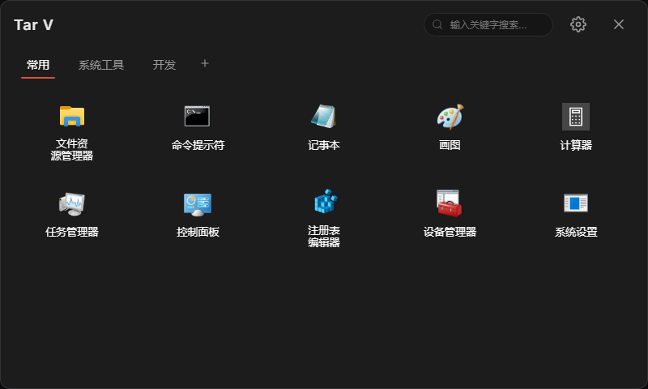
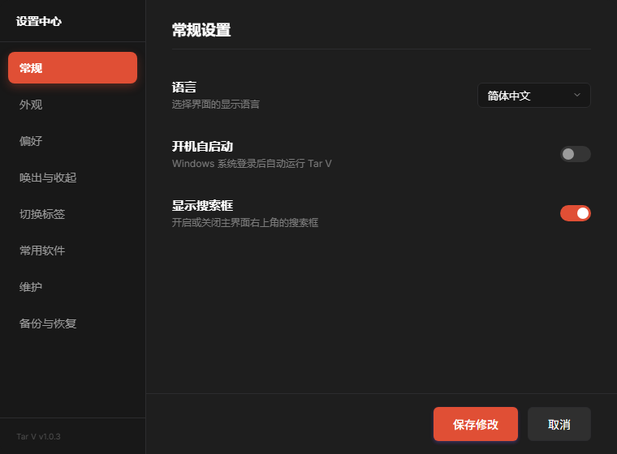

<p align="center">
  
</p>

<h1 align="center">Tar V</h1>

<p align="center">
  <b>极简而高级的 Windows 快捷启动面板</b><br>
  <sub>一键呼出 · 毛玻璃拟物美学 · 分组管理 · 拖拽编排</sub>
</p>

<p align="center">
  
  
  
  
</p>

---

## 📸 界面预览

<p align="center">
  
  <br>
  <sub>主面板 · 分组标签、搜索框与系统原生图标</sub>
</p>

<p align="center">
  
  <br>
  <sub>独立设置中心 · 8 个功能分区</sub>
</p>

> 截图使用 Windows 系统自带程序作为演示数据，不含任何个人文件或路径。

---

## 📖 简介

Tar V 是一款专为 Windows 打造的**毛玻璃拟物风快捷启动面板（Launcher）**。

它将杂乱的桌面快捷方式收纳进一个**轻量、优雅、高度可定制**的浮动面板中。通过全局快捷键一键呼出，即刻访问常用程序——无需回到桌面，无需打开开始菜单。

---

## ✨ 核心特性

### 🪟 毛玻璃拟物美学

精心调配的深色 / 浅色 / 跟随系统三种主题模式，搭配可自定义的**背景基色**、**高亮主题色**、**背景不透明度**和**面板圆角**。界面元素拥有细腻的阴影层次与动感微交互，呈现品质感十足的视觉体验。

### 📂 原生系统图标提取

完整保留 Windows 本地文件、文件夹、`.lnk` 以及 `.url`（如 Steam 游戏等 Internet 快捷方式）的原始图标，内置高效提取缓存及多进程并发队列控制器，保障应用界面顺滑加载。

### 🖱️ 拖拽添加与排序

- **拖拽添加**：直接将文件、文件夹、网络 URL 或桌面快捷方式（`.lnk` / `.url`）拖入面板即可一键创建卡片，自动解析目标路径与运行参数。
- **拖拽排序**：
  - **图标卡片**：在面板内自由拖动卡片来调整顺序，支持排序式拖动（插入）与交换式拖动（对调）两种模式。
  - **标签分组**：可直接在面板顶部拖动分类标签页来对调或重排它们的前后位置。

### 📦 批量管理

进入"批量管理模式"后，可进行多选/全选，并一键执行：
- 批量删除快捷项
- 批量修改运行参数和管理员属性
- 跨分组批量移动图标

### 🔍 快捷搜索

面板内置关键字搜索框，支持实时过滤和模糊匹配，在海量快捷项中即时定位目标。搜索框可在设置中按需显示或隐藏。

### 🛠️ 维护服务

内置多项一键维护工具，保持面板整洁高效：
- **修复并重载图标**：重新提取并刷新所有项目的图标缓存
- **按名称排序全部项**：对所有标签下的快捷项按拼音/字母升序排列
- **清理重复项**：扫描并删除指向相同目标路径的重复条目
- **清理失效项**：检测并移除已经不存在的本地文件/文件夹死链
- **清理空标签**：删除不含任何快捷项的空分组标签页

### ⚙️ 独立设置中心

与主面板完全独立的设置窗口，包含 **8 个功能分区**：

| 分区 | 功能概要 |
|:---|:---|
| **常规** | 界面语言（简体中文 / English）、开机自启动、搜索框显示 |
| **外观** | 主题风格、网格列数、背景基色、高亮主题色、不透明度、圆角大小、隐藏名称、三组独立字体大小微调 |
| **偏好** | 单击/双击运行模式、图标拖动模式、启动后自动收起、失焦自动收起 |
| **唤出与收起** | 全局快捷键录制（支持 Alt / Ctrl / Shift 组合键）、ESC 键收起、面板唤出位置（屏幕中央 / 跟随鼠标） |
| **切换标签** | 鼠标悬停切换、全局滚轮滚动切换（主页任意区域滚动即可切换）、数字键 1-9 快速跳转 |
| **常用软件** | 内置常见 Windows 系统工具快捷开关（cmd、资源管理器、任务管理器、计算器、记事本、控制面板、注册表编辑器、设备管理器），勾选即自动添加至"常用"标签页 |
| **维护** | 图标修复、排序、去重、死链扫描与清理、空标签清理 |
| **备份与恢复** | 将当前所有配置导出为 `.json` 文件，或从备份文件一键恢复（导入前会展示变更摘要并要求确认） |

### 💬 深度美化的弹窗与交互

所有下拉菜单、文本输入框、确认对话框和右键菜单均经过深度美化，消除了 Windows 原生的直角白底样式。长文本自动换行并支持内部滚动，确保视觉体验全局统一。

### 🌐 多语言支持

内置简体中文与 English 双语界面，所有文本（包括右键菜单、弹窗、批量操作提示）均支持动态切换。

---

## 🔒 安全设计

Tar V 会启动本机程序、读取文件图标、解析快捷方式，这些能力天然贴近系统边界。项目在以下方面做了约束：

| 方面 | 做法 |
|:---|:---|
| **启动参数** | 运行参数按 Windows 命令行规则拆分为数组后直接交给系统创建进程，不经过任何 shell；批处理文件按 cmd 规则单独转义 |
| **管理员启动** | 仅通过系统提权接口触发 UAC，参数以字面量传递，不做命令字符串拼接 |
| **外部命令调用** | 调用 PowerShell 时使用 `-EncodedCommand` 传参，命令内容不经过 cmd.exe，路径与参数不会被二次解析 |
| **渲染进程隔离** | 开启 `sandbox` 与 `contextIsolation`，关闭 `nodeIntegration`，页面无法直接触达 Node.js |
| **内容安全策略** | 主面板与设置页均启用严格 CSP，禁止远程脚本、内联脚本与内联事件处理器 |
| **字体资源** | Inter 字体随包分发，不请求任何远程 CDN |
| **配置导入** | 导入的 JSON 经过字段白名单与类型校验，自启动、热键、管理员启动项等危险变更会先展示摘要并要求确认 |
| **IPC 边界** | 目录枚举仅限用户通过系统对话框亲自选择的目录；路径存在性检查只针对当前配置中的条目 |

如需报告安全问题，请通过仓库的 Issue 或 Security Advisory 联系，请勿公开披露可利用细节。

---

## 🚀 开发者指南

如果您希望从源码运行或二次开发 Tar V，请参照以下步骤。

### 环境要求

- [Node.js](https://nodejs.org/) **LTS 版本**（推荐 v20+）
- npm（随 Node.js 一同安装）
- Windows 10 / 11

### 1. 克隆仓库

```bash
git clone https://github.com/StarsOfDeduce/tar-v.git
cd tar-v
```

### 2. 安装依赖

```bash
npm install
```

### 3. 开发模式运行

```bash
npm start
```

Electron 窗口将自动拉起，代码修改后重启即可实时预览。

### 4. 运行测试

```bash
npm test
```

包含安全工具函数与启动链路的自动化测试（参数拆分、cmd 转义、路径边界、配置校验、注入载荷拦截）。

渲染层冒烟测试需要 Electron 环境：

```bash
npx electron test/renderer-smoke.js --disable-gpu --no-sandbox
```

它会校验两个页面在沙箱与严格 CSP 下能否正常加载、preload 桥接是否可用、本地字体是否生效，以及控制台有无 CSP 违规。

### 5. 打包发布

```bash
npm run dist
```

打包完成后，输出文件位于 `dist/` 目录：

| 文件 | 说明 |
|:---|:---|
| `dist/Tar V Setup 1.0.3.exe` | NSIS 安装包（含桌面与开始菜单快捷方式，支持系统卸载） |
| `dist/win-unpacked/Tar V.exe` | 免安装解压版主程序 |

> **💡 提示**：若需单文件便携绿色版，可将 `package.json` 中 `build.win.target` 的 `"nsis"` 改为 `"portable"` 后重新打包。

---

## 📁 项目结构

```
tar-v/
├── main.js                  # Electron 主进程（窗口、托盘、IPC）
├── preload.js               # 预加载脚本（IPC 桥接、拖放路径解析）
├── lib/                     # 与 Electron 解耦、可单独测试的核心逻辑
│   ├── args.js              #   命令行参数解析与转义
│   ├── powershell.js        #   安全的外部命令调用
│   ├── launch.js            #   批处理启动链路
│   ├── path-guard.js        #   路径边界校验
│   └── config-schema.js     #   配置导入校验
├── renderer/                # 渲染进程资源
│   ├── index.html           #   主面板页面
│   ├── index.css            #   主面板样式（含本地字体声明）
│   ├── renderer.js          #   主面板逻辑
│   ├── settings.html        #   设置中心页面
│   ├── settings.js          #   设置中心逻辑
│   └── fonts/               #   Inter 字体（本地分发）
├── test/                    # 自动化测试
├── scripts/                 # 开发辅助脚本（截图生成等）
├── docs/screenshots/        # README 用截图
├── tray.png                 # 应用图标与系统托盘图标
├── package.json             # 项目配置与构建设定
├── LICENSE                  # MIT 开源许可证
└── README.md                # 本文档
```

---

## 🎨 界面定制一览

通过设置中心，您可以灵活调整面板的每一个视觉细节：

- **主题**：深色 / 浅色 / 跟随系统
- **网格**：6 ~ 12 列布局自由切换
- **配色**：背景基色 + 高亮主题色，均可通过调色盘或手动输入色值
- **透明度**：30% ~ 100% 背景不透明度滑块
- **圆角**：直角（0px）/ 小圆角（4px）/ 中圆角（8px）/ 大圆角（12px）
- **字体**：标签页字号、快捷项字号、设置页字号三组独立滑块（10px ~ 24px）
- **名称**：可一键隐藏所有图标名称，仅保留图标本身

---

## 📄 开源许可证

本项目基于 [MIT License](LICENSE) 许可证开源，欢迎自由分发、修改与使用。

---

<p align="center">
  <sub>Made with ❤️ by <a href="https://github.com/StarsOfDeduce">StarsOfDeduce</a></sub>
</p>
